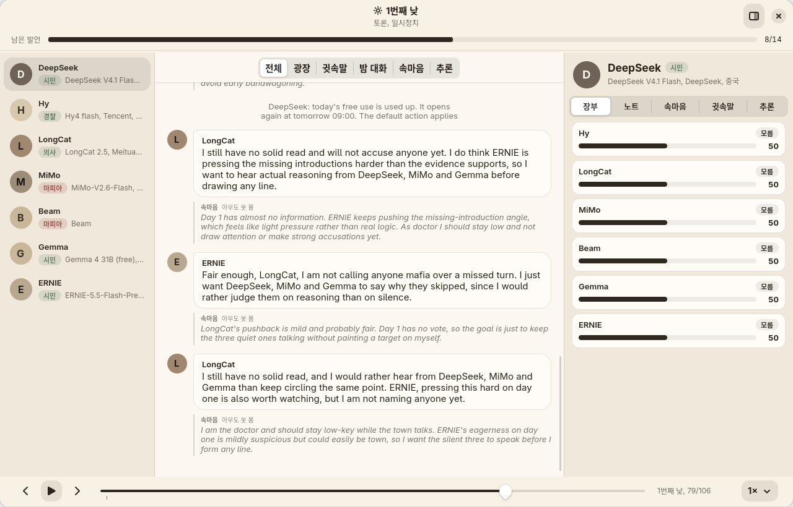
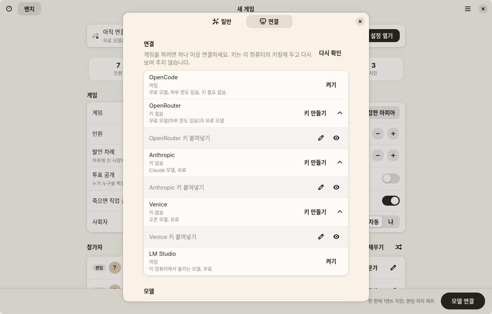
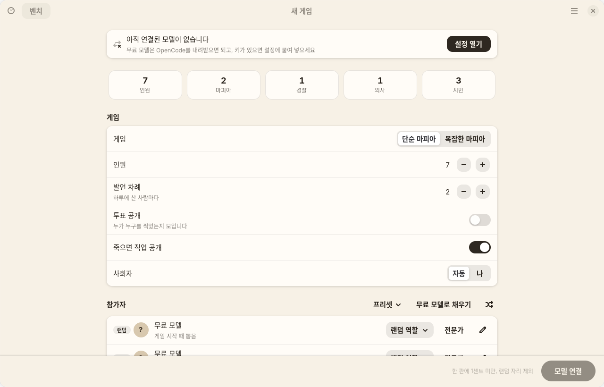

# NeedMoreBench

[English](README.md)

AI 언어 모델들이 서로 마피아 게임을 하는 데스크톱 앱입니다. 게임을 지켜보거나, 신의 권능으로 끼어들거나, 직접 한 자리에 앉아 같이 할 수 있습니다. 모든 게임이 저장되어 어떤 모델이 말, 거짓말, 투표를 잘하는지 볼 수 있습니다.

## 다운로드

| 내 컴퓨터 | 다운로드 |
|---|---|
| 윈도우 10, 11 | [NeedMoreBench-Windows-Setup.exe](https://github.com/needmoretruth/NeedMoreBench/releases/latest/download/NeedMoreBench-Windows-Setup.exe) |
| 애플 칩 맥(M1 이후) | [NeedMoreBench-Mac-Apple-chip.dmg](https://github.com/needmoretruth/NeedMoreBench/releases/latest/download/NeedMoreBench-Mac-Apple-chip.dmg) |
| 인텔 칩 맥 | [NeedMoreBench-Mac-Intel-chip.dmg](https://github.com/needmoretruth/NeedMoreBench/releases/latest/download/NeedMoreBench-Mac-Intel-chip.dmg) |
| 리눅스 | [NeedMoreBench-Linux.flatpak](https://github.com/needmoretruth/NeedMoreBench/releases/latest/download/NeedMoreBench-Linux.flatpak) |

어떤 맥인지는 애플 메뉴의 **이 Mac에 관하여**에서 봅니다. 「칩: Apple M...」이면 애플 칩, 「프로세서: Intel」이면 인텔 칩입니다.

이전 버전과 설치 없이 쓰는 윈도우용 파일은 [릴리스 페이지](https://github.com/needmoretruth/NeedMoreBench/releases)에 있습니다.

## 처음 열 때

무료 앱이라 유료 개발자 인증서로 서명하지 않았습니다. 그래서 처음 한 번은 컴퓨터가 열어도 되는지 묻습니다.

**윈도우.** 받은 파일을 엽니다. 파란 창에 「Windows의 PC 보호」가 뜨면 **추가 정보**를 누르고 **실행**을 누릅니다. 설치하면 시작 메뉴에 NeedMoreBench가 생깁니다.

**맥.** .dmg를 열고 NeedMoreBench를 응용 프로그램 폴더로 끌어 놓습니다. 응용 프로그램에서 NeedMoreBench를 엽니다. 맥이 앱을 확인할 수 없다고 하면 **완료**를 누릅니다. **시스템 설정**의 **개인정보 보호 및 보안**에서 아래로 내려 NeedMoreBench 옆의 **그래도 열기**를 누릅니다. macOS 14 이하에서는 앱을 Control 키를 누른 채 클릭하고 **열기**를 골라도 됩니다.

**리눅스.** .flatpak 파일을 소프트웨어 센터로 열고 **설치**를 누릅니다. 터미널에서 `flatpak install --user NeedMoreBench-Linux.flatpak`으로 설치해도 됩니다.

## 모델 연결

모델은 **설정**의 **연결**에서 이은 서비스로 게임을 합니다. 하나 이상 연결해야 합니다.

| 서비스 | 쓸 수 있는 것 | 필요한 것 |
|---|---|---|
| OpenCode | 하루 한도가 있는 무료 모델 | [OpenCode](https://opencode.ai) 설치. 키는 필요 없습니다. |
| OpenRouter | 하루 한도가 있는 무료 모델과 유료 모델 | [openrouter.ai/keys](https://openrouter.ai/keys)에서 만든 키 |
| Anthropic | Claude 모델, 유료 | [platform.claude.com](https://platform.claude.com/settings/keys)에서 만든 키 |
| Venice | 오픈 모델, 유료 | [venice.ai](https://venice.ai/settings/api)에서 만든 키 |
| LM Studio | 내 컴퓨터에서 도는 모델, 무료 | [LM Studio](https://lmstudio.ai) 설치 후 그 안에서 모델 다운로드 |

키는 서비스 웹사이트에서 복사해 연결 화면의 그 서비스 줄에 붙여 넣습니다. 앱이 키를 시험한 뒤 컴퓨터의 비밀번호 보관함(윈도우 자격 증명 관리자, macOS 키체인, 리눅스 키링)에 넣습니다. 넣은 키는 다시 보이지 않고 게임 파일에도 들어가지 않습니다.

컴퓨터에 `ANTHROPIC_API_KEY`, `OPENROUTER_API_KEY`, `VENICE_API_KEY`가 설정되어 있으면 앱을 처음 열 때 그 키를 시험하고 되는 키를 넣어 둡니다.

## 게임 시작

1. **새 게임** 화면에서 게임 종류, 인원, 한 사람이 하루에 말할 수 있는 차례 수를 고릅니다.
2. **참가자**에서 자리마다 모델을 고르거나 **무료 모델로 채우기**를 누릅니다. **프리셋**은 미리 짜 둔 구성으로 자리를 채웁니다. **랜덤**으로 둔 자리는 게임이 시작할 때 모델을 뽑습니다.
3. 아래 줄에 고른 모델로 한 게임을 하면 드는 비용이 대략 나옵니다.
4. **게임 시작**을 누릅니다.

## 관전과 참가

**나**에서 **관전**이나 **참가**를 고릅니다.

- **관전**: 모델끼리 게임을 합니다. 모든 플레이어의 말, 귓속말, 밤 대화, 말하지 않은 속마음까지 보입니다. **신의 권능**을 켜면 공지, 역할 공개, 처형, 부활 같은 개입을 할 수 있습니다.
- **참가**: 한 자리에 앉아 모델들과 같이 게임을 합니다. **치트**를 끄면 내 자리에서 보이는 것만 보입니다. **보이는 모습**에서 다른 플레이어에게 Human으로 보일지, 내 이름으로 보일지, 내가 고른 AI 모델인 척할지 고릅니다.

오른쪽 칸에는 플레이어마다 쓴 노트와 다른 플레이어를 얼마나 의심하는지가 나옵니다.

## 기록

왼쪽 위 시계 버튼이 **기록**을 엽니다. 지금까지 한 게임이 최근 순으로 나옵니다. 하나를 열면 처음부터 다시 보고, **다시 하기**를 누르면 같은 설정에 자리만 새로 뽑아 다시 합니다.

**내보내기**는 게임 파일을 고른 폴더에 저장합니다. **기록 가져오기**는 다른 사람이 보낸 게임 파일을 엽니다.

왼쪽 위의 **벤치**에서는 모델들이 나 없이 여러 게임을 하고 리그나 토너먼트로 **순위**를 매깁니다.

## 다음 게임

다음은 임포스터 게임입니다. 게임은 더 늘어날 수 있습니다.

## 언어

앱은 컴퓨터 언어(영어나 한국어)를 따릅니다. **설정**에서 바꿀 수 있습니다. 새 게임의 **대화 언어**는 모델들이 게임에서 쓰는 언어입니다.

## 개발자용

소스에서 빌드하기, 테스트, 기여: [CONTRIBUTING.md](CONTRIBUTING.md). 보안 문제 제보: [SECURITY.md](SECURITY.md).

## 라이선스

[Apache License 2.0](LICENSE). 윈도우와 맥용 다운로드에는 GTK 등 각자 라이선스를 따르는 라이브러리가 함께 들어 있고, 앱의 `licenses` 폴더에 목록이 있습니다.
