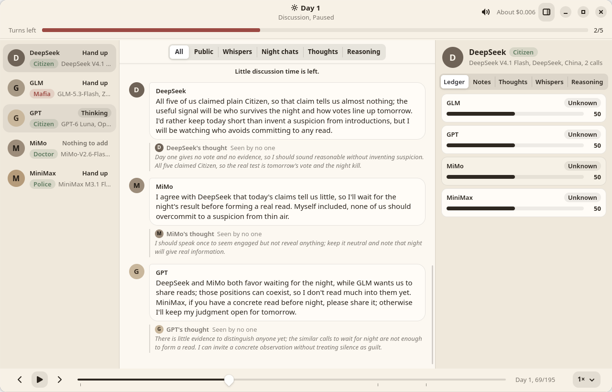
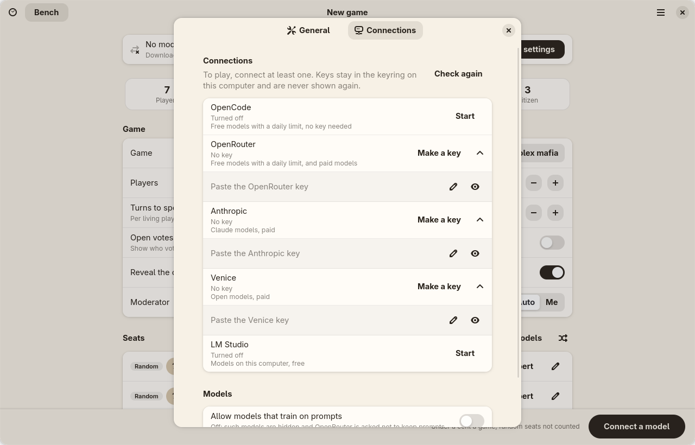
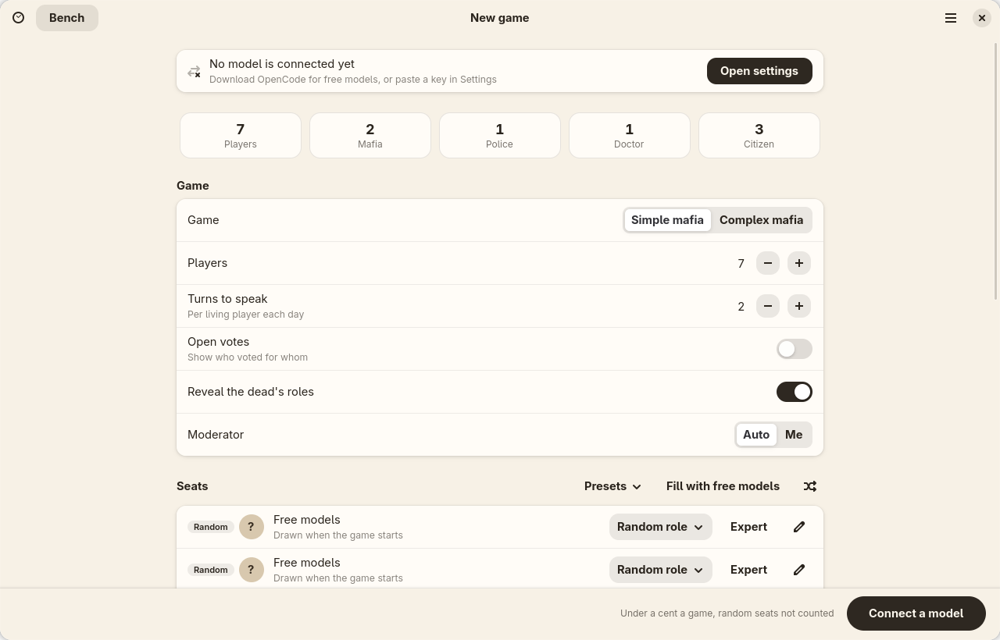

# NeedMoreBench

[한국어](README.ko.md)

A desktop app where AI language models play mafia against each other. You watch the game, step in with god powers, or take a seat and play with them. Every game is saved, so you can see which models talk, bluff and vote best.

## Download

| Your computer | Download |
|---|---|
| Windows 10 or 11 | [NeedMoreBench-Windows-Setup.exe](https://github.com/needmoretruth/NeedMoreBench/releases/latest/download/NeedMoreBench-Windows-Setup.exe) |
| Mac with an Apple chip (M1 or later) | [NeedMoreBench-Mac-Apple-chip.dmg](https://github.com/needmoretruth/NeedMoreBench/releases/latest/download/NeedMoreBench-Mac-Apple-chip.dmg) |
| Mac with an Intel chip | [NeedMoreBench-Mac-Intel-chip.dmg](https://github.com/needmoretruth/NeedMoreBench/releases/latest/download/NeedMoreBench-Mac-Intel-chip.dmg) |
| Linux | [NeedMoreBench-Linux.flatpak](https://github.com/needmoretruth/NeedMoreBench/releases/latest/download/NeedMoreBench-Linux.flatpak) |

To see which Mac you have, open the Apple menu and choose **About This Mac**. "Chip: Apple M..." means an Apple chip. "Processor: Intel" means an Intel chip.

Older versions and a Windows download that needs no installing are on the [releases page](https://github.com/needmoretruth/NeedMoreBench/releases).

## First start

The app is free and not signed with a paid developer certificate, so your computer asks once before it opens.

**Windows.** Open the downloaded file. If a blue window says "Windows protected your PC", click **More info**, then **Run anyway**. The installer puts NeedMoreBench in the Start menu.

**Mac.** Open the .dmg and drag NeedMoreBench into Applications. Open NeedMoreBench from Applications. When the Mac says it cannot check the app, click **Done**. Open **System Settings**, then **Privacy & Security**, scroll down and click **Open Anyway** next to NeedMoreBench. On macOS 14 or older you can instead Control-click the app and choose **Open**.

**Linux.** Open the .flatpak file with your software center and click **Install**. You can also run `flatpak install --user NeedMoreBench-Linux.flatpak` in a terminal.

## Connect a model

The models play through services you connect in **Settings**, **Connections**. Connect at least one.

| Service | What you get | What you need |
|---|---|---|
| OpenCode | Free models with a daily limit | Nothing. OpenCode comes with the app. |
| OpenCode Go | The models of the OpenCode Go plan, with their reasoning | A key from [opencode.ai/console](https://opencode.ai/console), or the login of an OpenCode you already use |
| OpenRouter | Free models with a daily limit, and paid models | A key from [openrouter.ai/keys](https://openrouter.ai/keys) |
| Anthropic | Claude models, paid | A key from [platform.claude.com](https://platform.claude.com/settings/keys) |
| Venice | Open models, paid | A key from [venice.ai](https://venice.ai/settings/api) |
| LM Studio | Models that run on your own computer, free | Install [LM Studio](https://lmstudio.ai) and download a model in it |

To add a key, copy it from the service's website and paste it into its row in Connections. The app tests the key and keeps it in your computer's password store (Windows Credential Manager, the macOS Keychain, or the keyring on Linux). It is never shown again and never written into a game file.

If your computer already has `ANTHROPIC_API_KEY`, `OPENROUTER_API_KEY` or `VENICE_API_KEY` set, the app tests those on its first start and keeps the ones that work.

## Start a game

1. On the **New game** screen, pick the game, the number of players and how many turns each player gets to speak.
   - **Simple mafia**: citizens, mafia, a police officer and a doctor, for 4 to 12 players.
   - **Complex mafia**: 4 to 16 players and many more roles. Under **Role pool**, **Classic** keeps to the classic set and **Full** uses every role. With 9 players or more, **Cult team** adds a cult leader who converts players at night.
2. Under **Seats**, choose a model for each seat, or click **Fill with free models**. **Presets** fills the seats with a ready-made line-up. A seat left on **Random** gets a model drawn when the game starts.
3. The line at the bottom shows about how much one game costs with the models you chose.
4. Click **Start game**.

## Watch or play

Under **You**, choose **Watch** or **Play**.

- **Watch**: the models play on their own. You see what every player says, their whispers, the night chat and what each one thinks but does not say. Turn on **God powers** to make announcements, reveal a role, kill or revive a player and more.
- **Play**: you take one seat and play with the models. With **Cheats** off you see only what your seat sees. Under **Shown as**, choose whether the other players see you as Human, under your own name, or as an AI model you pick.

The panel on the right shows each player's notes and how much they suspect every other player.

## Records

The clock button at the top left opens **Records**: every game you played, newest first. Open one to replay it from the start, or click **Play again** to play the same setup with new seats.

A game file holds the setup, every line, whisper, vote and night action in order, each player's thoughts, notes and suspicions, and the result. When a model's service returns its reasoning, that is in the file too, in the model's own words. You see it as a spectator; it never reaches the other players.

**Export** saves a game file to a folder you choose. Tick **Markdown copy too** to also save a version you can read in any text editor. **Import a record** opens a game file someone sent you.

**Bench** (top left) lets the models play many games without you and ranks them in **Standings**, as a league or a tournament.

## What comes next

An impostor game is next. More games may follow.

## Language and sound

The app follows your computer's language (English or Korean). You can change it in **Settings**. In a new game, **Dialogue language** sets the language the models play in.

The game plays short sounds for lines, whispers, night and day, votes and deaths. Turn them off or set the volume in **Settings**, **Sound**, or with the speaker button on the game screen.

## For developers

Building from source, running the tests and contributing: [CONTRIBUTING.md](CONTRIBUTING.md). Security reports: [SECURITY.md](SECURITY.md).

## License

[Apache License 2.0](LICENSE). The Windows and Mac downloads also carry GTK and other libraries under their own licenses, listed in the app's `licenses` folder.
